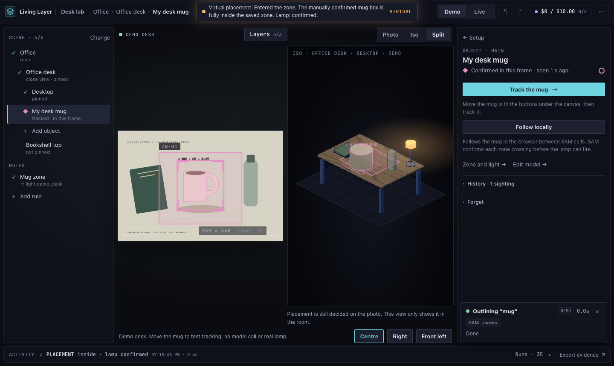
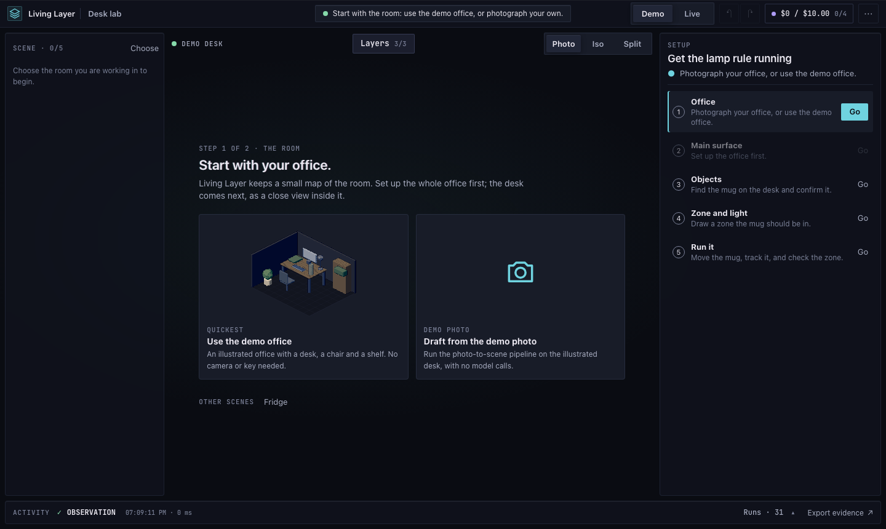

# Living Layer

Living Layer gives everyday objects a memory so your smart home can react to them.

**The problem.** Smart homes react to switches, door sensors and motion, but not to things. Home Assistant can tell that someone moved in the office. It can't tell that your mug is on the desk, that the monitor has been on for three hours, or that the milk in the fridge goes off tomorrow. A camera sees all of that, but only as pixels. Sending every frame to a vision model is slow, costly and hard on privacy, and when a model decides to switch a light you rarely learn why.

**What it does.** Living Layer turns one ordinary camera into a working model of the room. You mount it high in a corner and calibrate it once. From then on, what it sees is placed in an isometric twin of the room: the furniture, the things you choose to follow, and the people and pets who live there. You confirm which outline is your mug, so identity is always your call. Then you draw zones and say what should happen: _when the mug is inside this zone, turn on the desk lamp_.

It keeps watching from the server with no tab open, and it runs on your own machine. Frames are matched locally. Meta's models (Spark to read the room, SAM to outline things) are asked only when you allow it, under a daily spending limit you set. Each decision is saved with the reason behind it, so you can check afterwards why a light came on. Zones, things, their stats and who's home show up in Home Assistant as entities of their own, so the automations you already have can use them.

Each thing also keeps a small history: when the mug was last used, how long a screen was on, what in the fridge goes off first. You can ask the room about it in plain words. An AI brush changes the room's models when you select something and type what you want.

A bundled synthetic demo runs the whole loop with no API key, camera or lamp.



## How it works

The lab is scene first: it keeps a small map of your room, and every object, zone and light lives in it.

1. **Your office.** Photograph the room, or use the demo office. From a photo, [Meta Spark](https://dev.meta.ai/docs) lists what's there with loose boxes, [SAM 3.1](https://dev.meta.ai/docs/sam/reading-segmentation) outlines every box in one call, and code measures the rest from the masks: the desktop's corners, the camera, where each thing stands, and a pixel-art model fitted to each object. You review the draft (drag a corner, change or remove things, tick what to track) and save it in one go. That's two billed calls, or three with Spark's check.
2. **The office desk.** A close view inside the office, the one the camera watches. SAM outlines the desk on a close photo and its corners are measured for you to check, or you click them yourself. The pin maps the camera's pixels onto the desk, so a mug on the photo stands in the right spot in the iso room.
3. **Objects.** You name a thing and draw round it on the picture, and it is outlined on this machine. With _Let tracking call AI_ on, SAM can outline what you name instead, or what Spark suggests. You confirm which outline is your mug; identity is always your call.
4. **A rule.** _When the mug is inside this zone, turn on the desk lamp._ Draw the zone on the photo or the iso desk.
5. **Run it.** Move the mug and track it. When it stands in the zone (where it touches down, so a mug taller than the zone counts), Living Layer turns on one Home Assistant light, and the decision is saved with its reason.
6. **Leave it watching.** `Watch on the server` follows the mug, other objects and fixtures found in the camera with no tab open. Frames are matched locally, and a zone crossing is judged where the match has it, so lights switch with no SAM call; a lost thing is looked for by how it looks, and, with _Let tracking call AI_ on, SAM is asked only to find what nothing else can.

The scene outline on the left doubles as the setup checklist. The inspector on the right shows whatever you select, with one main action. Every model call and decision is in the activity drawer below, with what it cost.

**Let tracking call AI** is off by default, in the demo too. Off, outlines, following, finding lost things and zone decisions all run on this machine, and SAM by name, Spark's suggestions, SAM finding a placed thing and the watcher's SAM asks are refused or skipped. Turn it on from the spending readout in the top bar. A call you make by hand on one thing (SAM outlining what you drew round, or calibrating the camera) isn't gated by it.

Everything runs on your machine. `bun run start` serves on `127.0.0.1`; `bun run dev` listens on `0.0.0.0` (`HOST`), so a phone or another machine on your network can open the lab. Either way the API accepts only this machine's own names (loopback, its hostname and its IPv4 addresses) and rejects other hosts and origins.

### What else it does

- **Three demo rooms.** The office, a stocked fridge, and a Home room with a household in it. In the demo, **◷ Your day** over the room plays back a sample day on the twin, with each change and nudge on its timeline. `bun run reset demo` puts the running demo back to its preset.
- **Ask your room.** A question in plain words about the room's history (when was the mug last used, how long was the screen on). Spark reads the question; code counts from the stored events, and each answer cites them ([ask-room.md](docs/plans/ask-room.md)).
- **Room coach.** Off until you switch it on: every 5 minutes it looks at the room's stats and, when something is due, sends a short nudge, worded by one small Spark call ([room-coach.md](docs/plans/room-coach.md)).
- **Things and stats.** A thing can keep stats: power (a screen read off its own picture), last used, activity and occupied, kept as history. A state can follow a stat ([things-and-stats.md](docs/plans/things-and-stats.md)).
- **Fridge and food.** A food thing keeps its use-by day, when it was opened and how much is left, set by you on its card.
- **People and pets.** **＋ Add** in the outline has _Add a person_ and _Add a pet_. They are listed as _Who's home_, and each one can show in Home Assistant as a device tracker: home, or not_home while out ([people-and-pets.md](docs/plans/people-and-pets.md)).
- **Zones.** A room can have several zones, each switching its own devices or running steps (switch, wait, if, repeat, a desktop). A zone can count any or all of its things, watch for motion instead, or be a thing itself (_Make it a zone_, for a coaster or a tray). Right-click a zone in the outline to turn it off or on.
- **Home Assistant both ways.** _Devices it can switch_ picks the lights, switches and fans the lab may switch. _Show in Home Assistant_ makes entities of the lab's own over MQTT: whether a zone holds a thing, which zone a thing is in, a thing's stat, who's home, a switch for watching ([mqtt.md](docs/plans/mqtt.md)).
- **Desktop node.** `bun run desktop-node` on a desktop lets the lab turn its display on and off, open a page and show a banner; the lab finds it over mDNS and adopts it ([desktop-node.md](docs/plans/desktop-node.md)).
- **Trackers.** The watcher's **This machine | Apple Vision | GPU node** switch: Apple Vision on Apple silicon ([services/vision-tracker](services/vision-tracker/README.md)), or SAM 2.1 on an NVIDIA machine ([services/gpu-tracker](services/gpu-tracker/README.md)). Either only corrects the local match; neither judges a zone.
- **Cameras.** A saved RTSP camera plays in the tab over WebRTC through the camera relay (MediaMTX), and can have a substream the watcher follows things on, decoding the full stream only for stills ([streaming.md](docs/plans/streaming.md)).
- **The AI brush.** Select something on the picture or in the room and type the change you want: a new fixture, a colour, a size, a light's entity ([ai-brush.md](docs/plans/ai-brush.md)). _Model with AI_ in a thing's panel and _Edit with AI_ in the room's editor model one thing; `/studio` is the model editor as a page of its own.
- **And:** _Record_ in the top bar (or ⌘⇧E) downloads a video of the tab; _Filter_ lays a look or a privacy filter over the live camera for your eyes only, leaving the frames a scan or the tracker reads untouched; named saves are under **⋯** in the top bar.

See [docs/architecture.md](docs/architecture.md) for the details.

[docs/plans](docs/plans/README.md) has the design notes each part was built from, and the roadmap.

## Getting started

You need [Bun](https://bun.sh) 1.4+. It installs the packages, runs the server and the tests, and stores data with `bun:sqlite`. The web UI is built with Vite, and the browser tests also need Node 24.

```sh
bun install
bun run dev
```

Open http://127.0.0.1:43430. The API runs on port 43431.



Choose **Use the demo office**. Its frames come from a virtual camera high in the office’s front corner, already calibrated, so the desk comes pinned. Then:

1. In the outline, choose **＋ Add**, then **Follow it with the camera**. Type `mug` as the object, choose **Draw round it on the picture**, drag a box round the mug, then **Outline it** and **Confirm mug mask #1**.
2. Choose **Draw its zone →**, then **Draw zone**, drag a box around the mug on the photo or the iso desk, and **Save zone**.
3. Choose **Verify placement · virtual lamp**. The room warms up when the lamp turns on.
4. Move the mug with **Right** under the canvas, select **My desk mug**, draw round it again and choose **Outline it** to watch the rule decide again.

With _Let tracking call AI_ on, **Segment object** and **Track the mug** outline the mug by name instead, with the demo's own masks in place of SAM's.

The lamp is virtual in this mode and nothing leaves your machine.

## Going live

Copy `.env.example` to `.env` and fill in what you need. Restart the server after editing it.

The server keeps 30 days of runs and their pictures in `DATA_DIR` and deletes older ones at startup and daily, except what the desk still uses. `EVIDENCE_RETENTION_DAYS=0` keeps everything.

| Variable                                 | Purpose                                                                                                                                |
| ---------------------------------------- | -------------------------------------------------------------------------------------------------------------------------------------- |
| `HOST`                                   | Address the server listens on (default `127.0.0.1`); `bun run dev` sets `0.0.0.0`.                                                     |
| `MODEL_API_KEY`                          | Meta API key. Stays on the server and is never sent to the browser.                                                                    |
| `META_LIVE_ENABLED`                      | Set to `true` to allow live Meta calls.                                                                                                |
| `META_DAILY_SPEND_LIMIT_USD`             | Daily cap on Meta spend in USD (default 10). Changeable from the spending readout in the top bar.                                      |
| `HA_URL`, `HA_TOKEN`                     | Optional. Home Assistant origin and a long-lived token, instead of signing in from the lab (_Home Assistant → Devices it can switch_). |
| `HA_LIVE_ENABLED`                        | On by default; `false` switches nothing at all.                                                                                        |
| `HA_ENTITY_ID`                           | Optional. The main light, instead of ticking it in the lab.                                                                            |
| `HA_EXTRA_ENTITY_IDS`                    | Optional. More `light.*` entities, comma-separated.                                                                                    |
| `HA_SWITCH_ENTITY_IDS`                   | Optional. `switch.*`, `fan.*` or `input_boolean.*` entities, comma-separated.                                                          |
| `MQTT_URL`, `MQTT_USERNAME`, `_PASSWORD` | Optional. The MQTT broker Home Assistant reads, for entities you show there (e.g. `binary_sensor.ll_office_presence`).                 |
| `MQTT_LIVE_ENABLED`                      | Set to `true` to publish them. `MQTT_DISCOVERY_PREFIX` and `MQTT_BASE_TOPIC` change the topics.                                        |
| `MQTT_DEVICES`                           | Optional. Lights and switches switched over MQTT (e.g. Zigbee2MQTT): `light.desk=zigbee2mqtt/Desk lamp`, comma-separated.              |
| `CAMERA_STREAMS`                         | Optional. WHEP or `rtsp://` URLs of network cameras, where mDNS discovery is blocked.                                                  |
| `REMOTE_CAMERA_PORT`                     | HTTPS port for the phone camera page (default 43432). Only listens once a phone is paired.                                             |
| `REMOTE_CAMERA_HOST`                     | Optional. Address the pairing QR code points at, if the detected LAN address is wrong.                                                 |
| `REMOTE_CAMERA_CERT`, `_KEY`             | Optional. PEM certificate and key for the phone page (e.g. mkcert); else self-signed.                                                  |
| `CAMERA_RELAY`, `CAMERA_RELAY_PORT`      | `mediamtx` (default) plays saved RTSP cameras in the tab over WebRTC; `off` uses the MJPEG preview. Port 43433 and the two after it.   |
| `GPU_TRACKER_URL`, `GPU_TRACKER_TOKEN`   | Optional. The [GPU tracker](services/gpu-tracker/README.md) node the watcher also follows things with; used only when both are set.    |

Then switch to **Live** mode and go through the same steps with your own camera: mount it high in a corner of the room, looking across at the far corner, and **Calibrate the camera** on one of its frames (SAM outlines the floor and walls; you drag three marks and give the room’s size). Every scan, pin and picture then goes through that camera. Photos are only sent to Meta when you press a button that says it calls a model, or, with _Let tracking call AI_ on, when the watcher asks SAM to find a lost thing. The spending readout in the top bar shows today's spend against the limit.

You can also run the smoke checks from the command line:

```sh
bun run doctor                                     # checks config, makes no network calls
bun run fetch-model                                # the feature model the watcher uses, ~22 MB
bun run smoke                                      # offline run against the demo
bun run smoke --live --image ./desk.jpg            # live run (add --lamp to switch the light)
```

### Network cameras

Any Mac or Linux machine (a Raspberry Pi with a USB webcam works) can share its camera with the labs:

```sh
scripts/share-camera.sh                            # --list, --device, --size, --fps, --name; see --help
```

It needs `ffmpeg` and [MediaMTX](https://github.com/bluenviron/mediamtx), and offers to install whichever is missing (`--yes` skips the question): ffmpeg through your package manager, MediaMTX through Homebrew or as the checksum-verified release binary in `~/.local/bin`. The camera is encoded once to H.264 (VideoToolbox on macOS, passed through untouched on Linux when the camera already outputs H.264) and served as WebRTC (WHEP, what Living Layer plays, around 100 ms of latency) and RTSP. It is advertised over mDNS, so it shows up as a camera source in the workspace and the playground; **Find network cameras** rescans.

Its RTSP output is what lets the server watch it with no tab open: choose it as the camera, then **Watch on the server** on the mug. The server reads it with ffmpeg at 10 grey frames a second and keeps a full still five times a second for SAM and the feature model; with a substream, it follows things on the substream and keeps the main stream's keyframes as stills. `bun run fetch-model` downloads that feature model (DINOv3 ViT-S/16, about 22 MB, checksum-verified) into `DATA_DIR`; without it a lost thing goes straight to SAM, when tracking may call AI. A phone camera streams to the tab only, so it can be followed in the tab but not watched by the server.

### A phone as the camera

**Phone** next to **Camera** in the live workspace (or **Use a phone as the camera** in the playground) shows a QR code. Scan it with a phone on the same Wi-Fi, accept the certificate warning once, and allow camera access; the panel then offers **Use the phone camera**. The phone streams its back camera to the lab over WebRTC, peer to peer; the lab server only relays the two SDPs (`apps/server/src/remote.ts`). Phone browsers only share the camera over HTTPS, so the phone page is served on its own port with a certificate made in `DATA_DIR` by `openssl` (or `REMOTE_CAMERA_CERT`); that port opens with the first pairing and serves nothing but the page and its signalling, behind a random token. A new code retires the old one, and a code nobody scans stops working after 15 minutes.

## Development

```sh
bun run ci             # format, typecheck, lint, unit tests (sharded), web build
bun run verify         # format, types, lint, tests, the benches, the colour audit and unused exports, as one summary
bun run browser        # Playwright in a clean worktree on free ports, after `bunx playwright install chromium`
bun run format
```

`bun install` points git at `.githooks`, whose pre-push hook runs `ci`; `git push --no-verify` skips it. The browser suite is manual while this is a prototype: neither CI nor the hook runs it. (`bun run test:browser` runs Playwright in this checkout as it is.)

| Path              | What's there                                                                           |
| ----------------- | -------------------------------------------------------------------------------------- |
| `apps/web`        | React UI                                                                               |
| `apps/server`     | Fastify API, Meta/SAM and Home Assistant adapters, SQLite store                        |
| `apps/node`       | The desktop node (`bun run desktop-node`)                                              |
| `packages/domain` | Shared types, schemas, and the placement rule                                          |
| `services`        | The optional trackers: Apple Vision (Swift) and the GPU node (Python, SAM 2.1)         |
| `scripts`         | The checks, benches and tools `package.json` runs                                      |
| `docs`            | [Architecture](docs/architecture.md), [plans](docs/plans/README.md) and screenshots    |
| `design`          | The reference picture the room's tones are matched to                                  |
| `licenses`        | Third-party notices                                                                    |
| `testdata`        | Recorded SAM output and sample photos for the tests ([provenance](testdata/README.md)) |
| `tests`           | `bun test` integration tests and Playwright browser tests                              |

Local data (captures, raw SAM output, SQLite history, exports) is written to `.data/`, which is gitignored. Delete it with the server stopped to start fresh. The evidence export leaves out image bytes but does include object descriptions and your lamp's entity ID, so read it before sharing.

Contributions are welcome. See [CONTRIBUTING.md](CONTRIBUTING.md). To report a security problem, see [SECURITY.md](SECURITY.md).

## Meta Global AI Developer Hackathon

Living Layer was built for the [Meta Global AI Developer Hackathon](https://cerebralvalley.ai/e/meta-ai-developer-hackathon) (Indie track) between October 26 and November 4, 2026. The first commit is dated October 27, so the git history shows the whole build.

**Built during the event:** all the code and assets in this repository. That covers the web UI, the API server and its Meta and Home Assistant adapters, the shared domain types and placement rule, the SQLite evidence store, the synthetic demo, the illustrated desk and favicon, the tests, and the scripts.

**From third parties:**

- [Muse Spark](https://dev.meta.ai/docs) and SAM 3.1, Meta's models, called through Meta's API
- `@meta-sam/parser`, Meta's library for parsing SAM output and decoding masks. Its encoder was also used once to produce the synthetic mug mask ([details](testdata/README.md)).
- [Home Assistant](https://www.home-assistant.io/), which controls the lamp
- DINOv3 ViT-S/16, an optional local appearance model downloaded from [ONNX Community](https://huggingface.co/onnx-community/dinov3-vits16-pretrain-lvd1689m-ONNX), under its own DINOv3 license
- SAM 2.1 (`facebook/sam2.1-hiera-small`, Apache-2.0, through Hugging Face transformers), which the optional GPU tracker node runs ([services/gpu-tracker](services/gpu-tracker/README.md))
- Apple Vision's object tracker, part of macOS, which the optional vision tracker calls ([services/vision-tracker](services/vision-tracker/README.md))
- [SAM 3D Objects](https://github.com/facebookresearch/sam-3d-objects) (SAM License), experimental and off unless `SAM3D_ENABLED=true`, through mlx-spatial on this machine or fal.ai ([details](docs/plans/sam3d-experiment.md))
- [FFmpeg](https://ffmpeg.org/) (LGPL 2.1 or later; GPL 2 or later when built with its GPL parts) and [MediaMTX](https://github.com/bluenviron/mediamtx) (MIT), installed separately, which the server runs to read cameras and relay them to the tab
- Open source packages listed in `package.json`, including Fastify, React, Vite, sharp, zod, and the OpenAI SDK

## License

[MIT](LICENSE). The SAM stream parser (`@meta-sam/parser`) is under its own license; see [licenses/](licenses/README.md).
