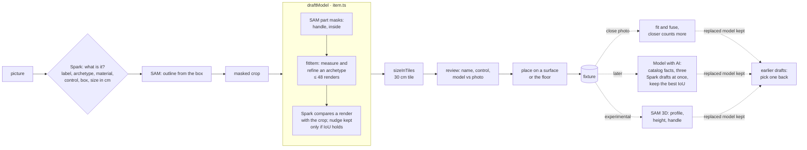
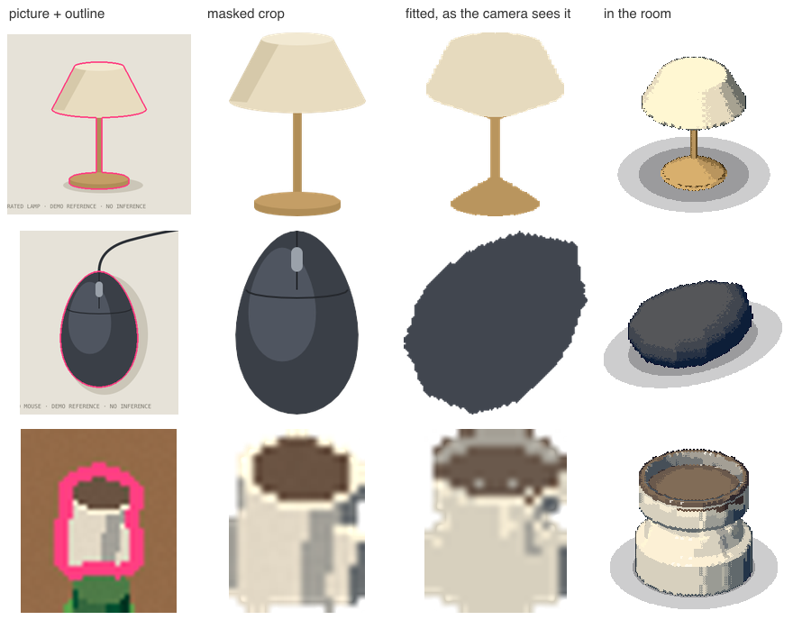

# From a picture to a fixture

How a picture of a thing becomes a fixture, as of November 4, 2026. A fixture is a modelled thing placed in a room, such as a lamp, a switch or a mouse. The data model and the reasons behind it are in [plans/fixtures.md](plans/fixtures.md), and the routes are in [architecture.md](architecture.md). This doc follows the picture through each step.

**In short:** Spark names the thing and boxes it. SAM outlines it from that box. The outline cuts a masked crop. A local fitter builds a voxel model from the crop, from one of a few archetypes (mug, lamp, box and so on). A single draft is helped live by SAM part masks and one Spark check; a scan fits each thing on this machine alone. A saved product it matches, or the camera, sets its real size; otherwise Spark's usual size does. The person reviews it, says what it controls, and places it. Afterwards the model can be improved in these ways, each keeping the model it replaces to pick back:

- **Take a close photo** fits another view and fuses it in, a closer one counting for more.
- **Model with AI** redraws it as free-form parts: Spark drafts three at once and the best match is kept. A live draft offers it straight after placing for shapes the fitter draws poorly.
- **Refine its shape with SAM 3D** (experimental) reconstructs a turned body whole and takes its profile and handle.

**Edit with AI** works on the model in the editor instead: Spark changes it as the person asks, and nothing is saved until the editor saves.

## The ways in

All of these end in the same model step (`draftModel`, `apps/server/src/item.ts`). They differ in where the picture and the outline come from.

| Way in                              | Route                        | Picture                                 | Outline                                                  | Model calls (live)                                                                                  |
| ----------------------------------- | ---------------------------- | --------------------------------------- | -------------------------------------------------------- | --------------------------------------------------------------------------------------------------- |
| **Add fixture**, from a photo       | `POST /api/fixtures/draft`   | a photo of the one thing                | SAM, from the box Spark gives                            | Spark class, SAM box, SAM part masks, Spark check (≤5)                                              |
| **A box on the desk or room photo** | `POST /api/fixtures/draft`   | the camera's frame (Spark sees the box) | SAM, from the person's own box on the whole frame        | the same                                                                                            |
| **Scan and map**                    | `POST /api/fixtures/scan`    | the pinned camera's frame               | one SAM call for every box Spark lists                   | Spark list, SAM boxes, SAM by name for up to 3 small things; each model is fitted locally           |
| **Room setup or room draft**        | `POST /api/scene/from-photo` | the calibrated camera's frame           | the draft's own SAM call (labelled by box)               | none for the model: catalogue, saved fixture or a cube                                              |
| **Lift off the room's picture**     | `POST /api/scene/separate`   | the room's Muse Image illustration      | SAM per fixture box (the demo uses the box's silhouette) | SAM, Muse Image for the base without them                                                           |
| **Another photo** of a fixture      | `POST /api/fixtures/photo`   | a close photo (the demo uses its own)   | SAM, from the box Spark gives                            | as a draft; then fused with the fits it has                                                         |

- **Demo mode** makes no model calls. It drafts from the bundled `lamp.svg`, `mouse.svg`, `monitor.svg` and `cat.svg`, whose outlines are each SVG's own `<name>-body` polygon, or from a box on the demo office, which picks one of the render's own outlines (`demoReference`, `demoDeskThing`, `apps/server/src/demo.ts`).
- **The room draft doesn't fit models.** Things no template draws get `draftModel` from `photo.ts`: a saved fixture of the same name, else the archetype's catalogue model, else a cube, in Spark's colour and size. Its masked crop is kept, so **Model with AI** can model it properly later.
- **Lifted fixtures are drawn as their cut-outs** on the illustration, not as their models. Unless there is a close photo of it, that cut-out is also what **Model with AI** takes as its picture.
- **A scan fits each thing locally** (`draftModel` with `live: false`, `apps/server/src/fixture/scan.ts`), in about a second each, with no Spark check: checking each crop took 30 s a thing and timed out on all six of one room's. What a scan does check is where small things are. Spark boxes a mouse across a room on a mug's handle, so up to three things no bigger than 20 cm (`MAX_NAMED_CHECKS`, `checkedByName`) are also found by SAM by name, one call each. Where SAM by name finds it alone away from Spark's box, its outline wins; where they disagree, the scan says so and leaves it. **Model with AI** refines one thing afterwards.

### Following a thing on the camera

A fixture's **In the camera** section gives it a sighting the camera follows, and that sighting is a picture **Model with AI** can model it from (below). Followed things such as the mug are modelled this way.

- **Draw round it on the picture** (`POST /api/segment` with a `shape`): a box or polygon on the camera's frame or photo, outlined on this machine, no model call.
- **Draw round it with SAM** (the same, with `sam`): SAM outlines what was drawn round, its box as the prompt, one billed call. It's the person's own call on one thing, so it isn't gated by _Let tracking call AI_. In the demo the answer is read off the render.
- **Find in camera** (`POST /api/fixtures/find`): SAM is pointed at where it should stand, from where the camera last saw it or its place in the room through the pin, one call. Only once tracking may call AI.

Each ends with the person confirming the outline (`POST /api/fixtures/anchor`).

A thing drawn with the room, such as a preset's desk or a group in the person's own layout, is made a thing of its own by **Make it a thing** (`POST /api/fixtures/promote`). One from the person's own room is pictured by the room draft's crop of it, so it can be modelled with AI next.

## Step by step

The demo's lamp, mouse and the mug on the demo desk (a box on its frame), drawn by `bun scripts/fixture-figures.ts`. The third column is what Spark sees beside the crop in a live check.

| thing    | archetype | IoU   | ΔE   | elevation read | renders |
| -------- | --------- | ----- | ---- | -------------- | ------: |
| lamp     | lamp      | 0.843 | 1.9  | 14°            |      48 |
| mouse    | device    | 0.938 | 4.1  | 80°            |       9 |
| desk mug | mug       | 0.943 | 11.6 | 28°            |      48 |

### 1. What is it (Spark)

`meta.fixtureClass` (`fixtureClassSchema`) returns a label, an archetype (mug, cup, bottle, can, book, box, plant, lamp, device, cat or generic), a material, a suggested control (`none`, `light` or `switch`), a loose box in thousandths and a usual size in cm. A name the person typed is passed along and names the draft. When the person draws the box, Spark sees only the part of the photo around it (`around`).

The person's photo is checked and re-encoded first (`validateImage`). The browser scales it to 1280 px.

### 2. Outline it (SAM)

One `segmentBoxes` call with the box. The biggest outline wins. If there's none, the request fails with a 422 asking for one thing that fills the frame, or for a bigger box.

### 3. Cut the masked crop

`maskedCrop` (`apps/server/src/images.ts`) cuts the outline's bounding box out of the picture and uses the mask as alpha. Everything after this sees only the thing's own pixels. The crop is stored with the run, so the editor's **Photo vs model** and later refits can use it.

### 4. Model it (`draftModel`)

1. **Part masks (live).** For archetypes with parts (`PART_CONCEPTS`), SAM segments each part inside the crop by name, such as a mug's handle or the liquid inside. The fitter uses these in place of its own guesses.
2. **Fit (local, `fitItem`, `packages/domain/src/item-fit.ts`).** For a turned body:
   - It clusters colours in OKLab, then merges lit and shaded clusters of one material.
   - It finds the axis from the narrowest rows, and a handle from rows that stick out on one side.
   - It reads the camera's elevation from the surface's foreshortening or the rim's ellipse. A box on the desk photo uses the pinned camera's elevation instead.
   - It corrects the side profile for how a lathe looks from above, finds bands down the front, and unwraps the visible half into a decal.
   - It renders the model and nudges its numbers until the silhouette matches the mask, in at most 48 renders.

   Spark's size goes in as `knownHeight`, its height over its longer side. Flat things (books, boxes, devices), plants and cats each have their own measure.

3. **Check (live).** Spark sees the crop beside `viewPng` (the model drawn flat from the photo's camera) and suggests corrections, each clamped to ±20% (`applyCheck`). They are kept only if the silhouette's IoU drops by no more than 0.01.

The draft keeps the fit record: archetype, parameters, IoU, ΔE, elevation, the crop and every assist. A label that names a monitor, display or screen gets the monitor template instead of a fit.

### 5. Size it

Sizes are in tiles of 30 cm (`ISO_TILE_CM`), the same in every scene, and the model is scaled to fit its box. Where the size comes from, most trusted first:

1. **A saved product.** When the person's name, Spark's label or its description names a product in the catalog (saved products and `apps/server/catalog`, offline and free), the draft takes its real size, laid along its own longer side, and the review says so. The catalog matches only when every word of a product's name is there, so "desk lamp" doesn't become a particular lamp.
2. **The camera** (a scan). `cameraScale` projects a box of Spark's usual size, standing where the scan found the thing, through the pin's camera, and sets its width against the outline's. Spark keeps the proportions and the camera gives the scale, between half and double; past that, the outline is likelier wrong and Spark's size stands.
3. **Spark's usual size** (`sizeInTiles(cls.sizeCm)`).

### 6. Review and place

The review shows the reference beside the model, the name, and `Light · Switch · Just a thing`. The suggested control is preselected, and only kinds with configured entities are offered. **Place it** shows a ghost of the model that follows the pointer onto the highest surface under it, or the floor, until a click saves it. `POST /api/fixtures/save` checks where it stands (`fixtureProblem`) and that its entity is configured, and keeps the draft's swatches and fit record, scored again against its crop.

In a live draft of a shape the fitter draws poorly (`SCULPT_FIRST`: a device, a box, a generic thing, a lamp), **Then model it with AI** is ticked, and Model with AI runs as soon as it is placed.

## Improving a fixture afterwards

The fixture panel offers each of these. The fit record keeps its crop's size (`cropPx`), and a fixture fitted from a crop under 60 px says so and puts **Take a close photo** first.

- **Take a close photo** (`POST /api/fixtures/photo`). Fitted as a draft is, then fused with the fits it has (`fuseFits`), counted up to four times as much as the last when its crop is that much wider. The bench shows why: the real mug's four views, fused, land 14% from its real shape, where one view alone was up to 45% off.
- **Model with AI** (below).
- **Edit with AI** (`POST /api/fixtures/edit`, `apps/server/src/fixture/edit.ts`), in the model editor, the room's or the Studio's (`/studio`). The person says what to change ("make the handle red"), and may brush parts on the preview to point the edit at them. Spark sees the model rendered as the editor has it now, the close photo it was fitted to when there is one, and the brushed parts marked, and gives the parts back changed only where asked, in one call; locked parts are put back. Nothing is saved: the answer comes back as the editor's draft, each edit can be undone there, and _Save model_ keeps them. The demo only recolours by name, offline.
- **Refine its shape with SAM 3D** (`POST /api/fixtures/refine3d`, experimental, [log](plans/sam3d-experiment.md)). Only for a turned body fitted to a photo, and only when SAM 3D is turned on (`SAM3D_ENABLED=true`, off by default) and set up (`SAM3D_MLX_WEIGHTS` locally, or `FAL_KEY`). It takes about 10 minutes locally, so the request answers at once and the page follows the job. `latheFromSplat` reads the splat's profile, height and handle in place of the fit's; colours and print stay the photo's. Outline overlap only guards against a reconstruction of something else (under 0.55), since the fitter bends its shape to one outline and outscores a right shape there.

**Earlier drafts.** A close photo, Model with AI and SAM 3D each keep the model they replace on the fixture, newest first, at most four. The panel shows the model beside them, front and back, with where each came from and its outline match, and **Use this** puts one back (`POST /api/fixtures/choose`). Each pick is noted in `fixture-picks.jsonl` in the data folder, what was chosen over what, as examples of which modeller suits which things.

## Model with AI (`POST /api/fixtures/sculpt`)

The fitter only knows its archetypes. **Model with AI** redraws any fixture as free-form parts, followed things such as the mug included. It runs live only, as a job the page follows step by step (`apps/server/src/fixture/sculpt.ts`):

1. **The picture** (`sculptPicture`), the first of these there is:
   - a close photo: one sent with the request (cut out by SAM, one call, and refused if SAM finds it nowhere or only in pieces), else the close photo its model was last fitted to;
   - its cut-out from the room's picture, if it (or a linked copy) was lifted;
   - for a followed thing, its last sighting, cut out by its outline. When that outline is only the box drawn round it, or has fallen apart, SAM cuts it out of the crop first (one call); if SAM can't, the box is used, what is round it too;
   - the crop its model was fitted to;
   - the room draft's crop of it, looked at from the room camera's elevation at that spot.

   A picture under 128 px is a room camera's crop, so Spark is shown it at least three times larger.
2. **Look it up** (only with a note, such as "it's a Dyson bladeless fan"). What saved products and the bundled catalog know about the note goes into Spark's prompt at once, and a product's real size replaces the fixture's proportions. Spark's web search (`research.ts`) runs alongside the drafts, not before them; what it finds sizes the saved model and is saved to the catalog, so the same thing comes from there next time. If the lookup fails, it carries on from the note and the picture.
3. **Its model as it is.** Rendered from the picture's camera and scored.
4. **Spark drafts it in parts** against the picture and that render, three ways at once at low effort (`SCULPT_DRAFTS`): each answers in 25–55 s, and the best of three matched about as well as one draft at full effort. There is no second round. A greyscale picture (from a night or infrared camera) is flagged, so Spark takes only shape from it, and its colours from the note, the product or plain neutrals.
5. **Keep the best draft**, whichever matches the picture's silhouette best, with any parts the person locked put back (`keepLocked`). If even the best overlaps the picture by less than 15% (`SCULPT_FLOOR`), it is of something else: the run fails and the model stays as it was.
6. **Save.** The model goes to the fixture and to its linked copies in other scenes, or, if it has a current state (`on`, `off`, `idle`, `sleeping`, `occupied` or any other), to that state. A looked-up product's size is laid along the fixture's own longer side.

Every run keeps its pictures with it: `picture.png`, `render-1.png` (the model as it was), `draft-<n>.png` (each draft), `render-2.png` (the best), `render-final.png` (with locked parts back) and `answers.json` (Spark's answers, which `bun run sculpt <run>` reads again). `bun run runs <run>` saves them to `out/runs/`.

**Re-apply or revert.** The AI dialog of the last modelling run offers _Revert_, which puts the desk back as it was before it. A past run's dialog offers _Re-Apply_ (`POST /api/fixtures/sculpt/reapply`): its model goes back on the fixture as it was saved then, with no model call, and the model it replaces is kept as an earlier draft.

## Costs and limits

Each live path works out its worst case before calling anything and refuses (429 `spend_limit`) if today's limit can't cover it:

- **A draft:** `fixtureDraftCeiling()`, up to five calls.
- **A scan:** one Spark list, one SAM call for the boxes, and up to three SAM calls by name for small things. The models cost nothing.
- **Another photo:** as a draft.
- **Drawing round a thing:** nothing on this machine; one SAM call with SAM. **Find in camera:** one SAM call.
- **SAM 3D:** no Meta calls. Local runs cost nothing; fal bills separately.
- **Model with AI:** three Spark drafts, plus one SAM call when a sent photo or a sighting has to be cut out, plus the lookup and up to five web searches when there's a note.
- **Edit with AI:** one Spark call.
- **Re-Apply:** no calls.

A run is billed by its Spark tokens.

## Where it falls short

These show up in the pictures above, in `bun run bench:fit`, and in [plans/sam3d-experiment.md](plans/sam3d-experiment.md):

- **Archetypes cap the shape.** The mouse comes out as a rounded blob, because `device` is a flat-family box. The mouse picture is drawn from almost straight above, so its height is a guess and its outline comes out turned. A live draft now offers Model with AI for these.
- **Small or low crops mislead the profile.** The desk mug is about 20 px across in the frame. Its fit reads its rim and body as two tiers, and its colour misses by ΔE 11.6. Across a room, a mug is about 17 × 23 pixels. The panel now flags these and asks for a close photo.
- **One view's shape is unreliable.** On the four real crops of one mug (`testdata/items/`, with its real size), the fitter's height over rim ranges from 0.63 to 1.31, up to 45% off the real one; the bench's `shape` and `spread` rows track it. Fused, the views come within 14%. SAM 3D's shapes of the same crops come within 3–9% and agree within 0.18.
- **Outline overlap can't judge a shape.** The fitter matches each crop's outline better than SAM 3D's right shape does. Judge a change to shape by the bench's real-size rows, not by IoU.
- **SAM 3D is experimental:** turned bodies only, about 10 minutes locally, no mesh at the tool's memory guard, and it guesses the sides a crop doesn't show (an inside it didn't see comes out white).
- **Model with AI** is the best of three drafts with no round to check its own, and is judged by silhouette only. At low effort a fan matched worse than one full-effort draft did (0.36 against 0.57).

## Pictures

`bun scripts/fixture-figures.ts` redraws `docs/media/fixtures/` from the demo's pictures, offline. Live runs keep their own pictures (`bun run runs <run>`). They are of a real home, so they stay local.
