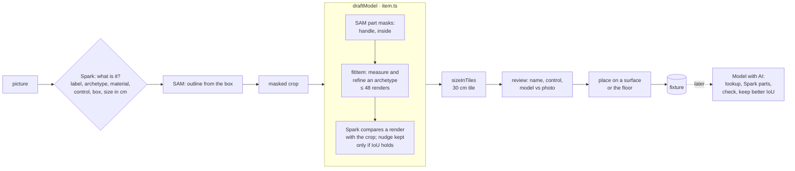

# From a picture to a fixture

How a picture of a thing becomes a fixture, as of November 2, 2026. A fixture is a modelled thing placed in a room, such as a lamp, a switch or a mouse. The data model and the reasons behind it are in [plans/fixtures.md](plans/fixtures.md), and the routes are in [architecture.md](architecture.md). This doc follows the picture through each step.

**In short:** Spark names the thing and boxes it. SAM outlines it from that box. The outline cuts a masked crop. A local fitter builds a voxel model from the crop, from one of a few archetypes (mug, lamp, box and so on), helped live by SAM part masks and one Spark check. Spark's usual size for the thing sets its size in 30 cm tiles. The person reviews it, says what it controls, and places it. Later, **Model with AI** can redraw the model as free-form parts, which Spark revises against renders.

## The ways in

All of these end in the same model step (`draftModel`, `apps/server/src/item.ts`). They differ in where the picture and the outline come from.

| Way in                              | Route                        | Picture                                 | Outline                                                  | Model calls (live)                                     |
| ----------------------------------- | ---------------------------- | --------------------------------------- | -------------------------------------------------------- | ------------------------------------------------------ |
| **Add fixture**, from a photo       | `POST /api/fixtures/draft`   | a photo of the one thing                | SAM, from the box Spark gives                            | Spark class, SAM box, SAM part masks, Spark check (≤5) |
| **A box on the desk or room photo** | `POST /api/fixtures/draft`   | the camera's frame (Spark sees the box) | SAM, from the person's own box on the whole frame        | the same                                               |
| **Scan and map**                    | `POST /api/fixtures/scan`    | the pinned camera's frame               | one SAM call for every box Spark lists                   | Spark list, SAM boxes; each model is fitted locally    |
| **Room setup or room draft**        | `POST /api/scene/from-photo` | the calibrated camera's frame           | the draft's own SAM call (labelled by box)               | none for the model: catalogue, saved fixture or a cube |
| **Lift off the room's picture**     | `POST /api/scene/separate`   | the room's Muse Image illustration      | SAM per fixture box (the demo uses the box's silhouette) | SAM, Muse Image for the base without them              |

- **Demo mode** makes no model calls. It drafts from the bundled `lamp.svg`, `mouse.svg`, `monitor.svg` and `cat.svg`, whose outlines are each SVG's own `<name>-body` polygon, or from a box on the demo office, which picks one of the render's own outlines (`demoReference`, `demoDeskThing`, `apps/server/src/demo.ts`).
- **The room draft doesn't fit models.** Things no template draws get `draftModel` from `photo.ts`: a saved fixture of the same name, else the archetype's catalogue model, else a cube, in Spark's colour and size. Its masked crop is kept, so **Model with AI** can model it properly later.
- **Lifted fixtures are drawn as their cut-outs** on the illustration, not as their models. That cut-out is also what **Model with AI** prefers as its picture.

## Step by step

The demo's lamp, mouse and the mug on the demo desk (a box on its frame), drawn by `bun scripts/fixture-figures.ts`. The third column is what Spark sees beside the crop in a live check.

| thing    | archetype | IoU   | ΔE   | elevation read | renders |
| -------- | --------- | ----- | ---- | -------------- | ------: |
| lamp     | lamp      | 0.843 | 1.9  | 14°            |      48 |
| mouse    | device    | 0.938 | 4.1  | 80°            |       9 |
| desk mug | mug       | 0.943 | 11.6 | 28°            |      48 |

### 1. What is it (Spark)

`meta.fixtureClass` (`fixtureClassSchema`) returns a label, an archetype (mug, cup, bottle, can, book, box, plant, lamp, device, cat or generic), a material, a suggested control (`none`, `light` or `switch`), a loose box in thousandths and a usual size in cm. A name the person typed is passed along and names the draft. When the person draws the box, Spark sees only the part of the photo around it (`around`).

The person's photo is checked and re-encoded first (`validateImage`). The browser scales it to 1280 px.

### 2. Outline it (SAM)

One `segmentBoxes` call with the box. The biggest outline wins. If there's none, the request fails with a 422 asking for one thing that fills the frame, or for a bigger box.

### 3. Cut the masked crop

`maskedCrop` (`apps/server/src/images.ts`) cuts the outline's bounding box out of the picture and uses the mask as alpha. Everything after this sees only the thing's own pixels. The crop is stored with the run, so the editor's **Photo vs model** and later refits can use it.

### 4. Model it (`draftModel`)

1. **Part masks (live).** For archetypes with parts (`PART_CONCEPTS`), SAM segments each part inside the crop by name, such as a mug's handle or the liquid inside. The fitter uses these in place of its own guesses.
2. **Fit (local, `fitItem`, `packages/domain/src/item-fit.ts`).** For a turned body:
   - It clusters colours in OKLab, then merges lit and shaded clusters of one material.
   - It finds the axis from the narrowest rows, and a handle from rows that stick out on one side.
   - It reads the camera's elevation from the surface's foreshortening or the rim's ellipse. A box on the desk photo uses the pinned camera's elevation instead.
   - It corrects the side profile for how a lathe looks from above, finds bands down the front, and unwraps the visible half into a decal.
   - It renders the model and nudges its numbers until the silhouette matches the mask, in at most 48 renders.

   Spark's size goes in as `knownHeight`, its height over its longer side. Flat things (books, boxes, devices), plants and cats each have their own measure.

3. **Check (live).** Spark sees the crop beside `viewPng` (the model drawn flat from the photo's camera) and suggests corrections, each clamped to ±20% (`applyCheck`). They are kept only if the silhouette's IoU drops by no more than 0.01.

The draft keeps the fit record: archetype, parameters, IoU, ΔE, elevation, the crop and every assist. A label that names a monitor, display or screen gets the monitor template instead of a fit.

### 5. Size it

`sizeInTiles(cls.sizeCm)` turns Spark's usual size into tiles of 30 cm (`ISO_TILE_CM`), the same in every scene. The model is scaled to fit that box.

### 6. Review and place

The review shows the reference beside the model, the name, and `Light · Switch · Just a thing`. The suggested control is preselected, and only kinds with configured entities are offered. **Place it** shows a ghost of the model that follows the pointer onto the highest surface under it, or the floor, until a click saves it. `POST /api/fixtures/save` checks where it stands (`fixtureProblem`) and that its entity is configured, and keeps the draft's swatches and fit record, scored again against its crop.

## Model with AI (`POST /api/fixtures/sculpt`)

The fitter only knows its archetypes. **Model with AI** redraws any fixture as free-form parts. It runs live only, as a job the page follows step by step:

1. **The picture.** The fixture's cut-out from the room's picture, if it was lifted. Otherwise the crop its model was fitted to. Otherwise the room draft's crop of it, looked at from the room camera's elevation at that spot.
2. **Look it up** (only with a note, such as "it's a Dyson bladeless fan"). The note is looked up as a product: saved products and the bundled catalog first, then Spark's web search (`research.ts`). What the web finds is saved to the catalog, so the same thing comes from there next time. A product's real size replaces the fixture's proportions. If the lookup fails, it carries on from the note and the picture.
3. **Its model as it is.** Rendered from the picture's camera and scored.
4. **Spark drafts it in parts** against the picture and that render, then **checks its draft** against a render of the draft. That's two calls. A greyscale picture (from a night or infrared camera) is flagged, so Spark takes only shape from it, and its colours from the note, the product or plain neutrals.
5. **Keep the better draft**, whichever matches the picture's silhouette better, with any parts the person locked put back (`keepLocked`).
6. **Save.** The model goes to the fixture and to its linked copies in other scenes, or to the fixture's current state (on or off) if it has one. A looked-up product's size is laid along the fixture's own longer side.

Every run's pictures (the picture, `render-1.png` to `render-3.png` and `render-final.png`) are kept with the run: `bun run runs <run>` saves them to `out/runs/`.

## Costs and limits

Each live path works out its worst case before calling anything and refuses (429 `spend_limit`) if today's limit can't cover it:

- **A draft:** `fixtureDraftCeiling()`, up to five calls.
- **A scan:** one Spark list plus one SAM call.
- **Model with AI:** two Spark calls, plus the lookup and its web searches when there's a note.

A run is billed by its Spark tokens.

## Where it falls short

These show up in the pictures above, and in [plans/sam3d-experiment.md](plans/sam3d-experiment.md):

- **Archetypes cap the shape.** The mouse comes out as a rounded blob, because `device` is a flat-family box. The mouse picture is drawn from almost straight above, so its height is a guess and its outline comes out turned.
- **Small or low crops mislead the profile.** The desk mug is about 20 px across in the frame. Its fit reads its rim and body as two tiers, and its colour misses by ΔE 11.6. Across a room, a mug is about 17 × 23 pixels, so a close photo or a zoomed crop does much better than the whole frame.
- **Proportions shift with the view.** On the four real crops of one mug (`testdata/items/`), the fitter's height over width at mid-height ranges from 0.63 to 1.25. SAM 3D, tried as an experiment, held 1.11–1.24 across the same crops.
- **Model with AI** is bounded by its two rounds, and is judged by silhouette only.

## Pictures

`bun scripts/fixture-figures.ts` redraws `docs/media/fixtures/` from the demo's pictures, offline. Live runs keep their own pictures (`bun run runs <run>`). They are of a real home, so they stay local.
