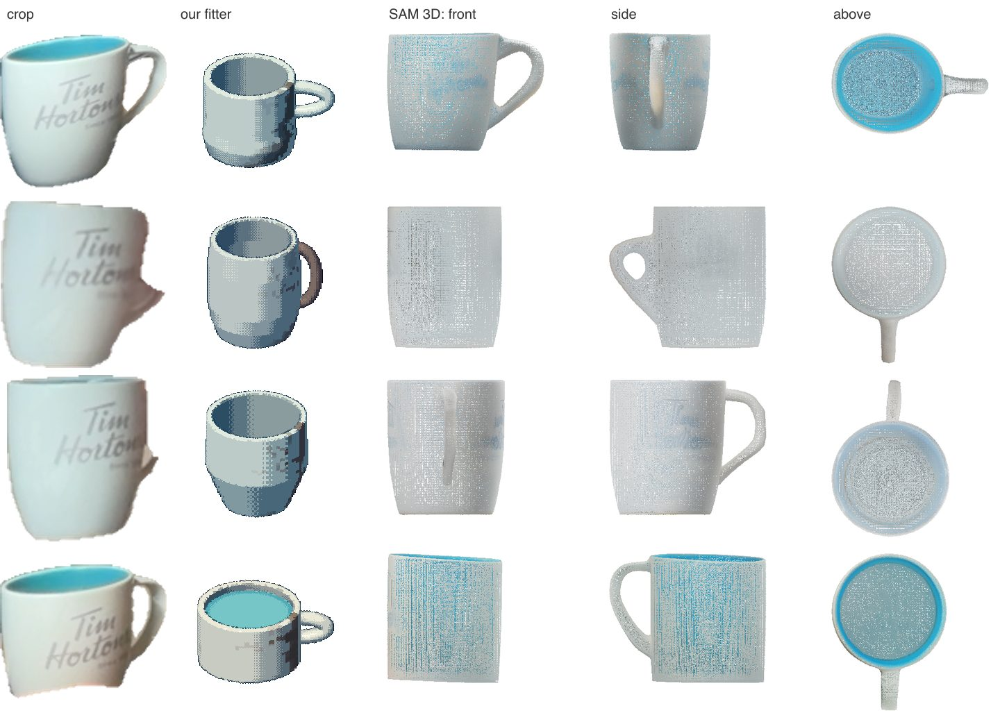
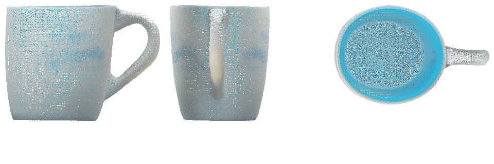

# SAM 3D experiment · log, November 2, 2026

**Experimental.** Nothing in the app uses this. It is one script (`scripts/experiments/sam3d.ts`), run by hand on four crops of one mug, to see whether Meta's SAM 3D Objects could replace or check the item fitter (`item-fit.ts`). Nothing here is tested or benched, and the setup depends on one machine.

Can SAM 3D turn a close crop of a thing into a model we could use? Tried on the four real mug crops in `testdata/items/`, which are 88–129 pixels across.

**Short answer:** for shape, yes, and it does better than the fitter. It gives a whole, hollow mug with a looped handle from every crop. Its height-to-width ratio is consistent across views (1.11–1.24 at mid-height), where the fitter's ranges from 0.63 to 1.25. But it takes about 9.5 minutes an object on this Mac, it makes no mesh at our memory limit, its size is in its own units, and it guesses whatever the crop doesn't show.

## Where it runs

- **Meta's own API has no 3D model.** `GET https://api.meta.ai/v1/models` lists `muse-wonder-1.0`, `muse-spark-1.1`/`1.2`/`1.3` (and their `-contributor` variants), `muse-image-1.0`, `muse-voice-transcribe-1.0` and `sam-3.1`. Muse Wonder is an agent model that only answers in text.
- **fal.ai hosts SAM 3D** (`fal-ai/sam-3/3d-objects`). It takes an image and masks and gives a splat (`.ply`), a GLB and a pose per object. It is billed and needs `FAL_KEY`. The script supports it, but it hasn't been run here.
- **Locally, through `mlx-spatial`** (a community MLX port, version 0.0.3, needing Python 3.13). The `appautomaton/sam-3d-objects-mlx` weights are 13.7 GB and not gated: 6.7 GB sparse-structure generator, 4.9 GB latent generator, 1.3 GB MoGe depth model, and the decoders. This is what was run, on an M4 Pro with 51 GB of memory:
  - weights in `/Volumes/1TB/AI/models/sam-3d-objects-mlx`
  - environment in `/Volumes/1TB/AI/envs/mlx-spatial` (`uv venv --python 3.13`, `uv pip install mlx-spatial`)
  - `.env` (local only): `SAM3D_MLX_WEIGHTS` and `SAM3D_MLX_BIN` point at them.

```bash
bun scripts/experiments/sam3d.ts --local              # every mug crop
bun scripts/experiments/sam3d.ts mug-front --local    # one; cached, so a rerun is instant
```

Each crop is put on white and scaled up 4×, and its alpha becomes the mask. Results go to `out/sam3d/<crop>-local/` (the splat, `trace.json` and `views.png`).

Quirks of the tool, which the script works around:

- It only writes under an `outputs/` folder of its working directory. The script runs it inside the crop's folder and moves the files up.
- It looks for MoGe at a relative path unless given `--moge-root <weights>/moge`.
- The mesh (`--glb-output`) estimated 44 GB for FlexiCubes and stopped at its 6 GB guard. The script skips the mesh unless asked (`--glb`). `--memory-profile large` is untried.

## Results



The splat drawn from its centres (z up), in its own colours. The proportions are measured on splats over 0.2 opacity, between the 1st and 99th percentiles. The body is the narrower of the x and y spreads, since a handle widens the other.

| crop      |  time |  splats | SAM 3D height ÷ body (base, mid, rim) | fitter's (base, mid, rim) | SAM 3D widest ÷ body | fitter's |
| --------- | ----: | ------: | ------------------------------------- | ------------------------- | -------------------: | -------: |
| mug-front | 506 s | 613,952 | 1.44, 1.21, 1.15                      | 0.98, 0.97, 0.97          |                 1.56 |     1.38 |
| mug-side  | 562 s | 785,152 | 1.39, 1.24, 1.26                      | 1.41, 1.25, 1.30          |                 1.32 |     1.20 |
| mug-low   | 569 s | 766,976 | 1.37, 1.17, 1.15                      | 1.45, 1.05, 1.06          |                 1.33 |        – |
| mug-wide  | 604 s | 767,360 | 1.14, 1.11, 1.11                      | 0.63, 0.63, 0.63          |                 1.31 |     1.26 |

The fitter's numbers are `fitItem` with archetype `mug` and no elevation given: height over twice the radius times the profile at that height. Its "widest" is the body plus the handle's reach. Peak memory was about 7.6 GB.



## What was learned

1. **Shape holds across views.** At mid-height SAM 3D gives 1.11–1.24 from four very different crops. The fitter gives 0.63 (wide) to 1.25 (side), and fits mug-front and mug-wide as squat cylinders with no taper. SAM 3D finds the narrowing base in three of the four.
2. **It fills in what it can't see, plausibly but not faithfully.** The side and low crops don't show inside the mug, so the inside came out white, not blue. mug-side barely shows the handle, which came out as a short loop. It's a strong prior, not a measurement.
3. **Even the surface print survives.** The faded "Tim Hortons" shows on the body in three of the splats, so its colour is good enough to sample swatches or a decal from.
4. **No real size.** The splat fits a unit box. Size has to come from the room camera, as it does now. (fal returns a pose and scale per object. Whether those are metric is unchecked.)
5. **Too slow to run live.** About 9.5 minutes per object locally. It would fit a background job when a fixture or item is saved, or fal if that's faster.

## If it goes further

- **Read a lathe fit off the splat:** the profile from slices up z, the handle's top, bottom and reach, and the inside and body colours. That way the renderer and editor stay as they are, and SAM 3D takes over only the guessing. Score it the way `bun run bench:fit` scores the fitter, and against the crop through `renderView`.
- **Try fal on the same four crops** for speed, the mesh and the pose metadata, before choosing local or hosted.
- **Things the fitter has no archetype for** (the cat tree, the fan) are where a free-form splat or mesh would help most. Untried.
